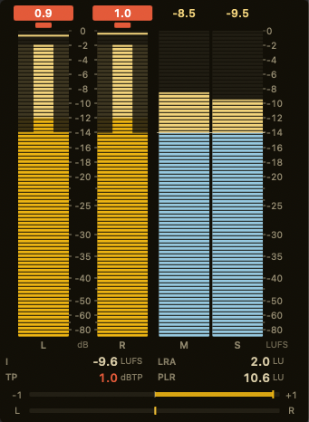
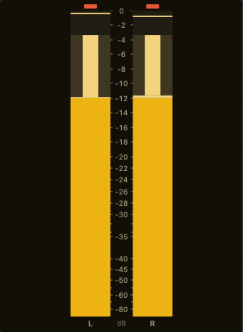
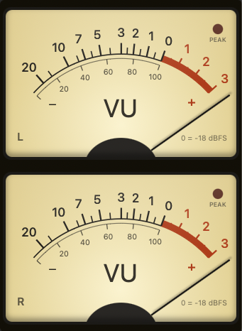
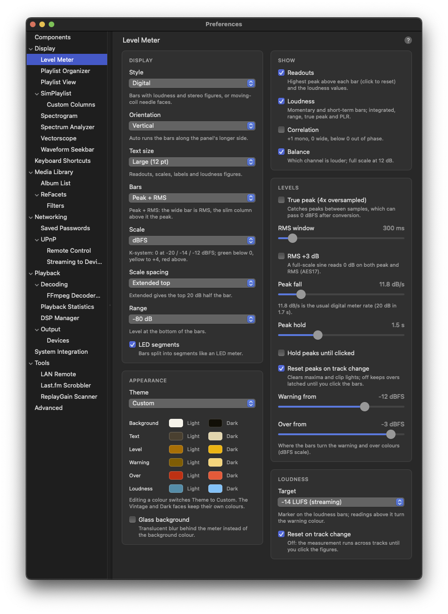

# Level Meter

A peak, RMS and loudness meter UI element for foobar2000 macOS, with an optional analog VU look. Contributed by [Scannou](https://github.com/Scannou).

| Digital | Levels only | Analog VU |
|---------|-------------|-----------|
|  |  |  |

## Features

### Level Bars

One bar per channel (L and R). In the default **Peak + RMS** mode the wide bar is the RMS level and a slim column down its middle rises from there to the peak, so both readings stay readable at a glance. **Peak** or **RMS** alone are available too.

| Part | Meaning |
|------|---------|
| **Wide bar** | RMS level over the RMS window (300 ms by default) |
| **Slim column** | Peak level: instant rise, then falls at the peak fall rate |
| **Hold line** | Highest recent peak, held for the peak hold time, then falling |
| **Readout above the bar** | Highest peak since the last reset |
| **Clip light** | Lights when a peak goes over 0 dBFS and stays lit until reset |

When a channel has clipped, its readout turns into a red label. Click a bar, readout or clip light to reset them; by default they also reset when a new track starts.

The bars take the level colour below the **warning** level (-12 dBFS by default), the warning colour up to the **over** level (-3 dBFS), and the over colour above it.

### True Peak

With **True peak** on (the default), peaks are measured between the samples as well: the signal is oversampled 4x, the way BS.1770 describes it. Loud masters often reach +0.5 to +2 dBTP between samples even when no sample is over 0 dBFS; those inter-sample overs light the clip light. Turn it off to read sample peaks only.

### Scales

| Scale | Description |
|-------|-------------|
| **dBFS** | 0 at digital full scale |
| **K-20 / K-14 / K-12** | 0 at -20 / -14 / -12 dBFS RMS. Green below 0, yellow up to +4, red above, whatever the warning and over settings are |

**Extended top** spacing gives the top 20 dB about half the bar, so loud passages show more detail and the bottom end is compressed; **Linear** spaces every dB evenly. The range runs from -24 to -120 dB at the bottom. Scale numbers step in round values (1, 2, 5, 10, 20 dB) and never crowd.

### Loudness

Loudness after ITU-R BS.1770 and EBU R128, shown as two bars beside the level bars and a block of figures underneath.

| Reading | Meaning |
|---------|---------|
| **M** (bar) | Momentary loudness, 400 ms window |
| **S** (bar) | Short-term loudness, 3 s window |
| **I** | Integrated loudness of the whole measurement, gated (-70 LUFS absolute, -10 LU relative) |
| **LRA** | Loudness range: the spread between the 10th and 95th percentile of short-term loudness (EBU Tech 3342) |
| **TP** / **PK** | Highest true peak (or sample peak) of the measurement; turns red above -1 dB |
| **PLR** | Peak-to-loudness ratio: TP minus I. Low values mean heavily limited masters |

A line across the M and S bars marks the **target** loudness (-14 LUFS by default, presets from -9 to -24 LUFS); readings above it turn the warning colour.

The measurement starts again on each new track (optional) or when you click the loudness bars or figures. While playback is paused, M and S fall to silence but I and LRA keep their values, and the paused stretch does not count towards them. A mono source is measured once, as BS.1770 specifies, so it reads 3 dB lower than the same signal on both channels.

### Correlation and Balance

Two thin bars below the figures, each with its own switch.

| Bar | Meaning |
|-----|---------|
| **Correlation** | +1 mono, 0 wide or unrelated, below 0 out of phase (red: cancels when summed to mono) |
| **Balance** | Which channel is louder; full deflection at 12 dB difference, warning colour beyond 3 dB |

Both read over a 300 ms window and rest in the middle while the signal is below about -60 dBFS.

### Analog VU

The **Analog VU** style draws backlit moving-coil faces instead of bars: a scale from -20 to +3 VU with the red zone above 0, a percentage scale underneath, a peak LED and a needle with a soft shadow.

| Setting | Choices |
|---------|---------|
| **Face** | Vintage (warm backlit cream), Dark, or the theme's colours |
| **Meters** | Two faces (side by side or stacked, whichever gives the bigger faces), or one face with two needles |
| **Ballistics** | VU, or PPM in the DIN, BBC / EBU or Nordic style |
| **Reference** | The sine level that reads 0 VU: -24 to -6 dBFS, -18 by default |

The VU movement is a damped needle: it reaches 99% of a step in 300 ms with about 1.3% overshoot, and stops against a pin just past +3. The PPM styles rise fast and fall slowly (20 dB in 1.5 s, 24 dB in 2.8 s and 20 dB in 1.7 s); their timing follows each family's published characteristics but is not a certified implementation. All of them are calibrated so a steady sine at the reference level reads 0.

Loud modern masters keep a -18 dBFS reference pinned at the top of the scale; a reference around -10 dBFS lets the needles swing around 0 instead. The **peak LED** lights while the peak passes its threshold (-1 dBFS by default). A mono source shows one face labelled MONO.

### Layout

The digital meter runs its bars upright or across the panel; **Auto** picks whichever follows the panel's longer side. On small panels the extras give way in a fixed order (balance, correlation, loudness figures, readouts, then the loudness bars) so the level bars keep their room. **Text size** (Small 9 pt, Medium 10 pt, Large 12 pt, Extra large 14 pt) scales the readouts, scales, labels and figures, and the layout grows with them.

### Color Themes

Fourteen presets set the meter's six colours (background, text, level, warning, over, loudness) for light and dark appearance at once. They share names with the other visualisers' themes: the CRT phosphors P31 green, P3 amber, P4 white and P7 blue (listed first), then Default (Blue), Classic (Green), Nord, Dracula, Gruvbox, Solarized, Tokyo Night, Catppuccin, Monokai, Sunset. Editing a colour switches the theme to Custom. Colours are drawn in Display P3, like the other visualisers' (see [Theme colours](theme-colours.md)).

### Glass Background

Optional translucent behind-window blur instead of a solid background colour (same effect as the other visualisers).

## Mouse

| Action | Result |
|--------|--------|
| Click the level bars, readouts or clip lights | Reset peaks, hold lines and clip lights |
| Click the loudness bars or figures | Start a new loudness measurement |
| Click an analog face | Reset peaks |
| Right-click (or Ctrl-click) | Reset Peaks, Reset Loudness, Digital / Analog VU, Preferences... |

## Configuration

Access settings via **Preferences > Display > Level Meter**, or right-click the element and choose **Preferences...**. Changes apply live. Settings that do not apply to the chosen style are hidden, and the page follows style changes made from the context menu.



### Display

| Setting | Description | Range | Default |
|---------|-------------|-------|---------|
| Style | Bars or needle faces | Digital, Analog VU | Digital |
| Orientation | Direction of the bars; Auto follows the panel's longer side | Auto, Vertical, Horizontal | Auto |
| Text size | Readouts, scales, labels and loudness figures | Small (9 pt), Medium (10 pt), Large (12 pt), Extra large (14 pt) | Medium |
| Bars | What the level bars show | Peak + RMS, Peak, RMS | Peak + RMS |
| Scale | Scale numbering and zones | dBFS, K-20, K-14, K-12 | dBFS |
| Scale spacing | How the dB values spread along the bar | Extended top, Linear | Extended top |
| Range | Level at the bottom of the bars | -24, -40, -48, -60, -72, -80, -90, -120 dB | -60 dB |
| LED segments | Split the bars into segments | On / Off | Off |

### Appearance

| Setting | Description | Default |
|---------|-------------|---------|
| Theme | Colour preset (Custom + 14 presets) | Classic (Green) |
| Colours (Light / Dark) | Background, text, level, warning, over and loudness colour per appearance | Set by the theme |
| Glass background | Translucent blur instead of the background colour | Off |

### Show

| Setting | Description | Default |
|---------|-------------|---------|
| Readouts | Highest peak above each level bar and the loudness values | On |
| Loudness | Momentary and short-term bars and the loudness figures | On |
| Correlation | Phase correlation bar | On |
| Balance | Left / right balance bar | On |

### Levels

| Setting | Description | Range | Default |
|---------|-------------|-------|---------|
| True peak | Measure peaks between samples (4x oversampled) | On / Off | On |
| RMS window | Time the RMS level is averaged over | 50-3000 ms | 300 ms |
| RMS +3 dB | A full-scale sine reads 0 dB on both peak and RMS (AES17) | On / Off | Off |
| Peak fall | How fast the peak column falls; 11.8 dB/s is the usual digital meter rate (20 dB in 1.7 s) | 3.0-60.0 dB/s | 11.8 dB/s |
| Peak hold | How long the hold line stays before it falls | Off, 0.1-5.0 s | 1.5 s |
| Hold peaks until clicked | Keep the hold line until you click the bars | On / Off | Off |
| Reset peaks on track change | Clear maxima, hold lines and clip lights when a track starts | On / Off | On |
| Warning from | Where the bars turn the warning colour (dBFS scale) | -40 to 0 dBFS | -12 dBFS |
| Over from | Where the bars turn the over colour (dBFS scale) | -40 to 0 dBFS | -3 dBFS |

### Loudness

| Setting | Description | Range | Default |
|---------|-------------|-------|---------|
| Target | Marker on the loudness bars | -9, -11, -14, -16, -18, -23 (EBU R128), -24 (ATSC A/85) LUFS | -14 LUFS |
| Reset on track change | Start a new measurement when a track starts | On / Off | On |

### Analog

| Setting | Description | Range | Default |
|---------|-------------|-------|---------|
| Face | Look of the meter face | Vintage, Dark, Theme colours | Vintage |
| Meters | Number of faces | Auto, Two faces, One face with two needles | Auto |
| Ballistics | Needle movement | VU (300 ms), PPM DIN, PPM BBC / EBU, PPM Nordic style | VU |
| Reference | Sine level that reads 0 VU | -24 to -6 dBFS | -18 dBFS |
| Peak LED | LED on the face that lights on peaks | On / Off | On |
| Peak LED at | Threshold of the peak LED | -20 to 0 dBFS | -1 dBFS |

## Layout Editor

Add Level Meter to your layout using any of these names:
- `level_meter` (recommended)
- `Level Meter`
- `levelmeter`
- `vu_meter`
- `VU Meter`
- `vumeter`
- `peak_meter`
- `loudness_meter`
- `foo_jl_levelmeter`
- `jl_levelmeter`

The meter works tall and narrow beside other panels, or wide and short under a seekbar. Example layout with the meter to the right of the spectrum analyzer and vectorscope:
```
splitter horizontal style=thin
  waveform-seekbar
  splitter vertical style=thin
    spectrum
    vectorscope
    level_meter
  simplaylist
```

## Technical Details

### Audio

- Samples come from `visualisation_stream_v2::get_chunk_absolute`; each frame reads the audio played since the previous frame, with a 1 s backlog so a late frame does not leave a gap in the loudness measurement
- Mono is duplicated to both channels for the bars (and measured once for loudness); surround uses the first two channels (front left / front right)
- The meter keeps measuring while its window is covered or minimised, and stops redrawing a few seconds after the audio stops
- On a track change foobar2000 reports the new track slightly before it is heard, so up to about a second of the previous track's end can land in the new measurement

### Measurement

- Loudness: K-weighting for any sample rate (the BS.1770 filters through the bilinear transform), 10 ms sub-blocks for the momentary and short-term windows, 400 ms gating blocks every 100 ms, histograms in 0.01 LU steps for the integrated value and the range
- True peak: 48-tap polyphase interpolator at 4x; the unoversampled phase passes the samples through, so it never reads below the sample peak
- VU: damped second-order needle driven by the rectified signal, calibrated to read a sine's RMS; PPMs: fast exponential rise and linear-in-dB fall, each calibrated on a 1 kHz sine

### Rendering

- The meter is drawn with Core Graphics by an SDK-free renderer, from one snapshot of all readings per frame, on a 60 fps `NSTimer`
- `Scripts/preview.sh` renders sample panels to PNG without foobar2000, for checking the design

### Lifecycle

- An `initquit` service stops every live view's timer and releases its stream before the core tears down the visualisation backend
- Settings persist via `fb2k::configStore` under the `foo_jl_levelmeter.` prefix (cfg_var does not persist on macOS v2)

### Tests

The detectors, loudness, true peak, scales and layout are SDK-free and unit-tested (`Scripts/run_tests.sh`), including the BS.1770 filter coefficients and the EBU Tech 3341 / 3342 loudness and range cases; the tests gate `build.sh`. See [Testable Core Pattern](testable-core-pattern.md).

## Requirements

- foobar2000 v2.x for macOS
- macOS 12.0 (Monterey) or later
