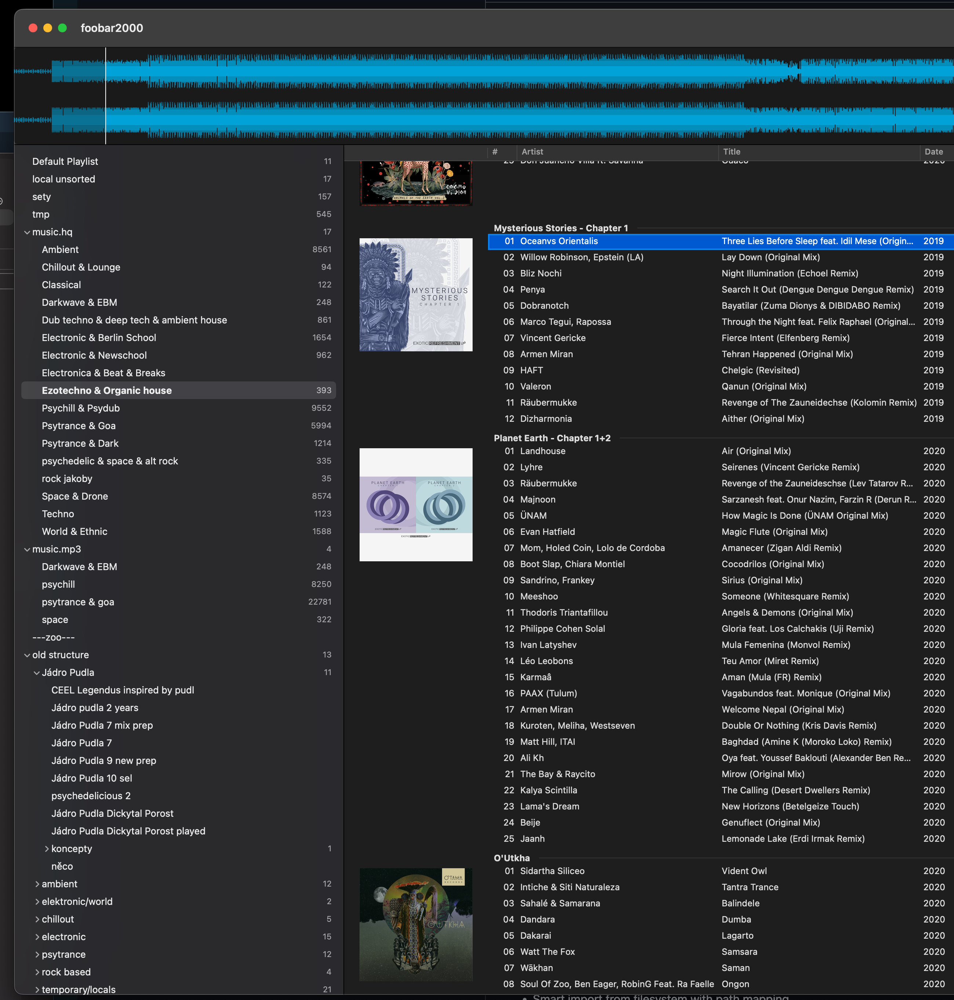
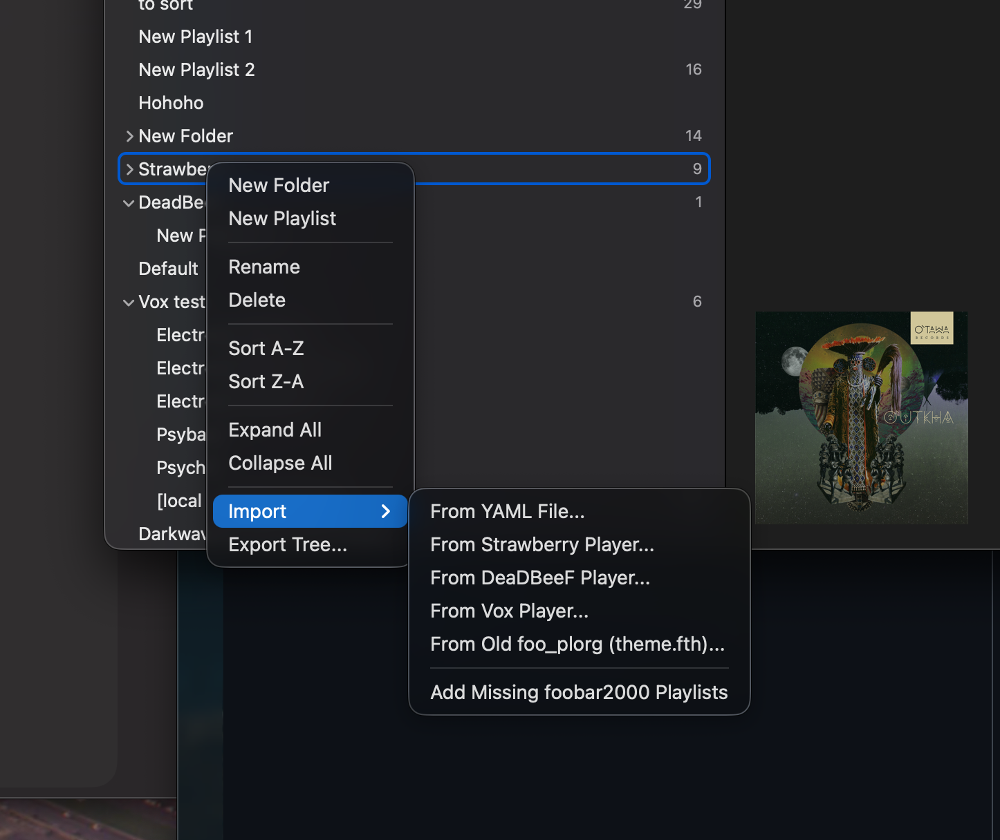
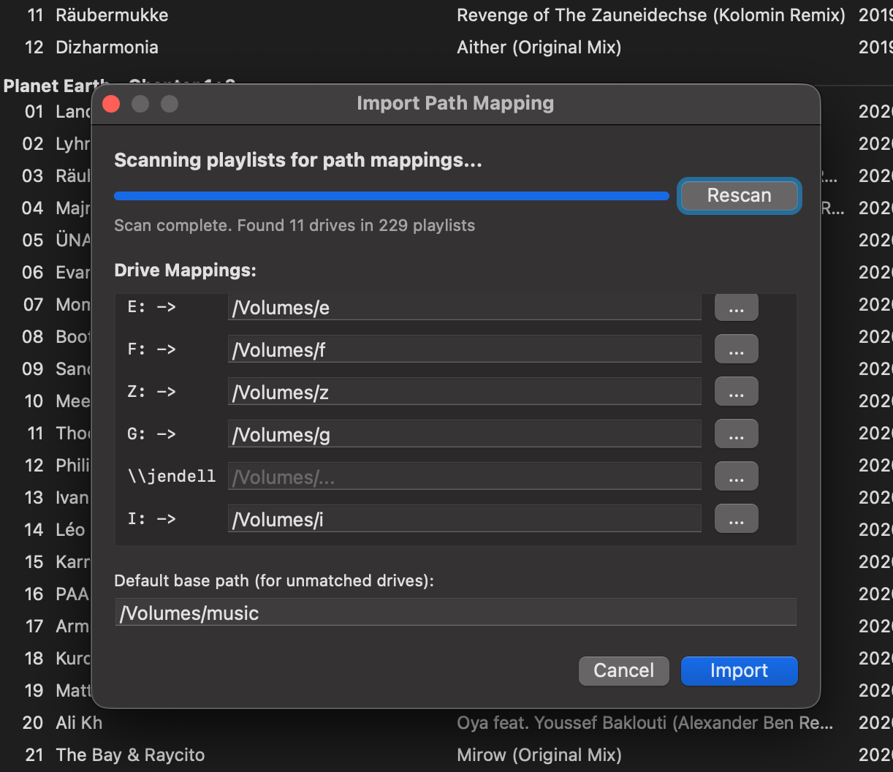
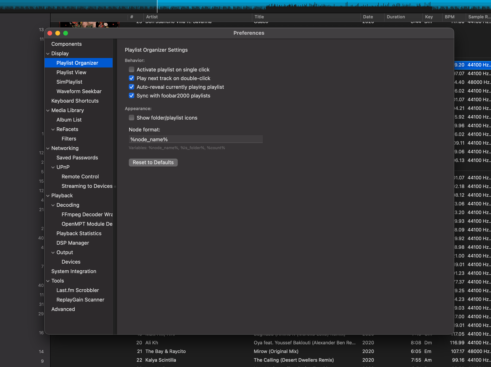

# Playlist Organizer

Hierarchical playlist organization with folders for foobar2000 macOS.

## Features

### Folder Organization

Organize your playlists into folders with unlimited nesting depth. Create a logical hierarchy that matches how you think about your music.

<!-- Screenshot: Folder hierarchy example -->


### Tree Lines Display

Optional Windows Explorer-style tree connection lines for visual clarity. Works best for single-level nesting.

<!-- Screenshot: Tree lines enabled vs disabled -->

### Drag & Drop

- Drag playlists into folders
- Reorder playlists and folders
- Move items between folders

### Auto-Sync

Automatically syncs with foobar2000's playlist manager:
- New playlists appear in the organizer
- Deleted playlists are removed
- Renamed playlists update automatically

### Import/Export

Share your organization structure:
- **Export Tree...** - Save the current structure to a YAML file
- **Import** - Load a structure from a YAML file, Strawberry, DeaDBeeF, Vox, or Windows foo_plorg (theme.fth)
- **Add Missing foobar2000 Playlists** - Add playlists that aren't in the tree yet

<!-- Screenshot: Import menu -->


### Path Mapping

When importing a Windows foo_plorg `theme.fth`, map its drive letters to folders in your local library:

<!-- Screenshot: Path mapping dialog -->


## Configuration

Access settings via **Preferences > Display > Playlist Organizer**

<!-- Screenshot: Settings panel -->


### Available Settings

| Setting | Description | Default |
|---------|-------------|---------|
| Node Format | Title formatting string; saved but not applied yet (the tree shows plain names, with counts in their own column) | `%node_name%` |
| Show Tree Lines | Display tree connection lines | Off |

### Configuration File

The tree structure is stored as human-readable YAML at:
```
~/Library/foobar2000-v2/foo_plorg.yaml
```

Example:
```yaml
# Playlist Organizer Configuration
node_format: "%node_name%"

tree:
  - folder: "Rock"
    expanded: true
    items:
      - playlist: "Classic Rock"
      - playlist: "Alternative"
  - folder: "Electronic"
    items:
      - playlist: "Ambient"
      - playlist: "Techno"
  - playlist: "Favorites"
```

## Layout Editor

Open **View → Layout → Edit Layout...**, add a line with one of these names where you want the panel, and click **Apply**:
- `plorg` (recommended)
- `playlist_organizer`
- `foo_jl_plorg`

Example layout (organizer beside the playlist):
```
splitter vertical style=thin
  plorg
  simplaylist
```

## Context Menu

Right-click options:
- **New Folder / New Playlist** - Create a folder or a playlist
- **Rename** - Rename the selected item
- **Delete** - Remove the selected items. Playlists are also deleted from foobar2000 unless **Keep playlists in foobar2000** is ticked; a deleted folder's contents move up one level unless **Also delete all playlists inside folders** is ticked
- **Sort A-Z / Sort Z-A** - Sort the contents of the right-clicked folder
- **Expand All / Collapse All** - Toggle all folders
- **Import** (submenu) / **Export Tree...** - Configuration management
- **Tools > Repair Volume UUIDs...** - Fix playlist paths after a disk's volume ID changed

## Requirements

- foobar2000 v2.x for macOS
- macOS 12.0 (Monterey) or later

## Links

- [Main Project](../README.md)
- [Changelog](../extensions/foo_jl_plorg_mac/CHANGELOG.md)
- [Build Instructions](../extensions/foo_jl_plorg_mac/README.md)
