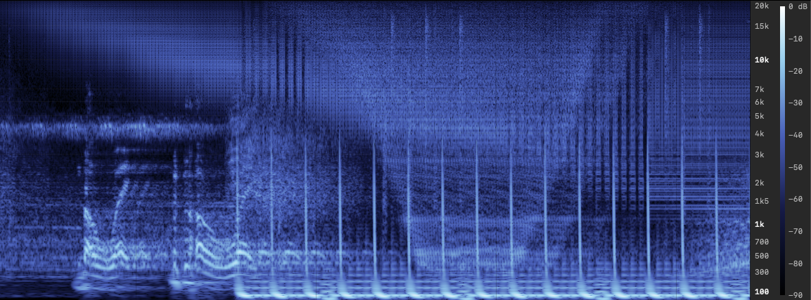
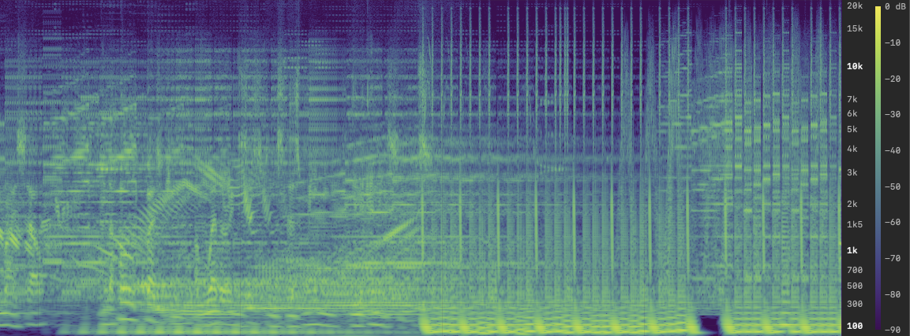
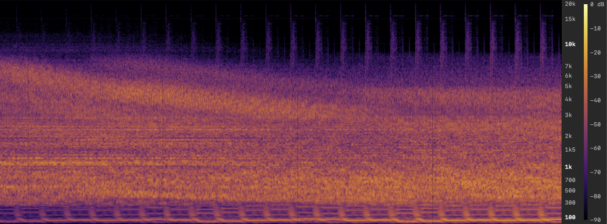
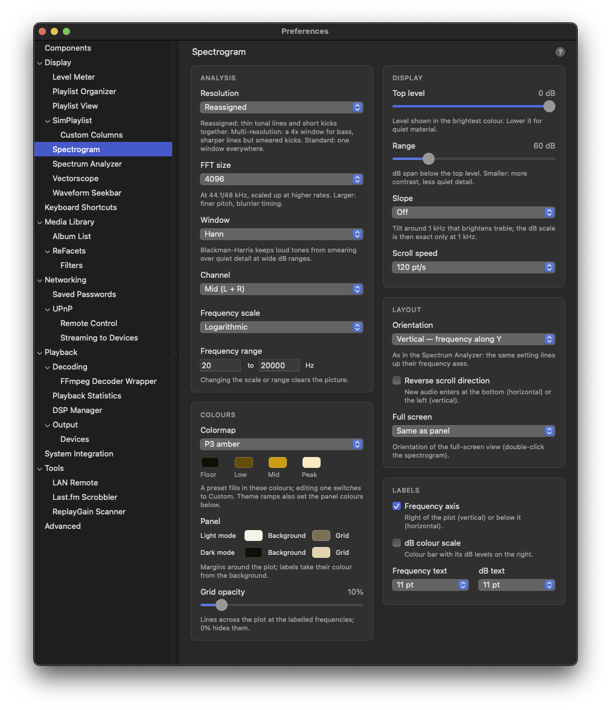

# Spectrogram

A scrolling spectrogram UI element for foobar2000 macOS: frequency on the vertical axis, time on the horizontal axis, level as color. Contributed by [Scannou](https://github.com/Scannou).

## Features



### Scrolling Display

New audio enters at the right edge and moves left at a fixed speed. Columns sit on a fixed time grid derived from the playback position (one per device pixel of travel), so the picture is the same whatever the frame timing. Pausing or stopping playback holds the picture; seeking carries on from the new position.

### Orientation

The same setting as in the Spectrum Analyzer, so the two panels line up when placed side by side or one above the other:

| Orientation | Frequency axis | Time | Frequency labels |
|-------------|----------------|------|------------------|
| **Vertical** (default) | Along Y, low at the bottom | New audio enters at the right and moves left | Right of the plot |
| **Horizontal** | Along X, low on the left | New audio enters at the top and moves down | Below the plot |

**Reverse scroll direction** makes new audio enter at the left (vertical) or the bottom (horizontal) instead, for a panel placed on the other side of the spectrum. Changing either setting clears the picture.

### Resolution

One plain FFT cannot be sharp in both pitch and time: a window long enough to draw bass notes as thin lines smears every kick over a third of a second. Three modes trade this differently (window sizes at 44.1/48 kHz with FFT size 4096):

| Mode | Below 2 kHz | Above 4 kHz | Look |
|------|-------------|-------------|------|
| **Reassigned** (default) | 4096 samples, reassigned | 1024 samples, reassigned | Thin tonal lines and short kicks at the same time |
| **Multi-resolution** | 16384 below 200 Hz, 4096 above | 1024 samples | Thin bass lines, kicks smeared over ~0.4 s |
| **Standard** | 4096 samples | 4096 samples | One window everywhere |

**Reassignment**: each column also runs an FFT through the window's derivative, which tells, per bin, the frequency the signal really has there. The bin's energy is moved to that frequency, so a tone's several-bin lobe collapses into a line while the window stays short enough for sharp transients (kick drums show as narrow streaks, with their pitch sweep). The standard spectrum is drawn 18 dB down underneath, so noise and texture stay visible.

Crossovers (200-400 Hz in multi-resolution, 2-4 kHz in both split modes) blend the neighbouring windows in dB. Windows are doubled at 88.2/96 kHz and quadrupled above, so resolution stays the same across sample rates.

Levels are calibrated in dBFS: a full-scale sine reads 0 dB.

### Frequency Scales

| Scale | Description |
|-------|-------------|
| **Logarithmic** | Equal height per octave |
| **Mel** | Between logarithmic and linear; more room for mids and highs |
| **Linear** | Equal height per Hz |

### Colormaps

Inferno, Magma, Classic (black, blue, purple, red, yellow, white), Ice, Heat, Plasma, Viridis, Turbo, Grayscale.




Below a separator, one ramp per Spectrum Analyzer color theme (Default (Blue), Classic (Green), Nord, Dracula, Gruvbox, Solarized, Tokyo Night, Catppuccin, Monokai, Sunset, P31 green, P3 amber, P4 white, P7 blue): the theme's dark background rising through its accent color to near white, so the two panels can match.

**Custom**: every preset fills in four color wells (Floor, Low, Mid, Peak); editing one switches the colormap to Custom, a ramp through those four colors.

The plot starts out in the colormap's floor color; the margins around it use the panel background (see Panel below), so a colormap with a strong floor color such as Viridis does not tint the whole panel.

### Axis and Scale

- **Frequency axis**: labels right of the plot next to the dB color scale (vertical), or below it (horizontal), de-cluttered to fit (round numbers first). Same style as the Spectrum Analyzer: monospaced, with the decades (100, 1k, 10k) brighter and bold
- **Grid lines**: lines across the plot at the labelled frequencies, with adjustable opacity
- **dB color scale**: color bar on the right edge with the level each color stands for
- The axis and the scale auto-hide when the panel is too small

### Frequency Readout

Click and hold the left mouse button to show a marker with the frequency and nearest note (A4 = 440 Hz) under the cursor; drag to scrub. The marker line and the note take the colormap's accent: the most vivid color of its upper half (Inferno: orange, Viridis: yellow, theme ramps: the theme's accent).

### Context Menu

Right-click the element:

| Item | Description |
|------|-------------|
| **Freeze** | Stop scrolling while playback continues |
| **Clear** | Drop the picture drawn so far |
| **Preferences...** | Open the settings page |

## Configuration

Access settings via **Preferences > Display > Spectrogram**, or right-click the element and choose **Preferences...**. Changes apply live.



### Analysis

| Setting | Description | Range | Default |
|---------|-------------|-------|---------|
| FFT size | Base window length at 44.1/48 kHz | 1024, 2048, 4096, 8192, 16384 | 4096 |
| Resolution | Reassigned, Multi-resolution or Standard (see above) | | Reassigned |
| Window | Hann, or Blackman-Harris (cleaner at wide dB ranges, slightly broader lines) | | Hann |
| Channel | Signal analysed | Mid (L + R), Left, Right, Side (L - R) | Mid |
| Frequency scale | Axis mapping | Logarithmic, Mel, Linear | Logarithmic |
| Range (Hz) | Lowest and highest displayed frequency | 10-2000 to 1000-96000 | 20 to 20000 |

Changing the frequency scale or range clears the picture, since older columns would no longer line up with the axis.

### Display

| Setting | Description | Range | Default |
|---------|-------------|-------|---------|
| Colormap | Color ramp | Custom, 9 colormaps, 14 theme ramps | Inferno |
| Colors | Floor, Low, Mid, Peak of the ramp; filled in by the chosen preset, editing switches to Custom | | From Inferno |
| Top level | Level shown in the brightest color | -40 to 0 dB | 0 dB |
| Range | dB span below the top level | 40 to 140 dB | 90 dB |
| Slope | Tilt around 1 kHz that brightens treble | Off, 1.5, 3, 4.5, 6 dB/octave | Off |
| Scroll speed | Travel along the time axis | 30, 60, 120, 240 pt/s | 120 pt/s |
| Orientation | Frequency along Y (vertical) or X (horizontal), as in the Spectrum Analyzer | Horizontal, Vertical | Vertical |
| Reverse scroll direction | New audio at the left / bottom instead of the right / top | On/Off | Off |
| Show frequency axis | Frequency labels right of the plot (vertical) or below it (horizontal) | On/Off | On |
| Show dB color scale | Color bar on the right | On/Off | On |
| Frequency labels | Font size | 8-16 pt | 11 pt |
| dB scale labels | Font size | 8-16 pt | 11 pt |

With a slope set, the dB color scale is exact only at 1 kHz.

### Panel

| Setting | Description | Default |
|---------|-------------|---------|
| Background (light / dark) | Margins around the plot; labels are derived from it so they stay readable | Light gray / near-black |
| Grid lines (light / dark) | Color of the frequency lines across the plot | Neutral gray |
| Grid opacity | Opacity of those lines (0% hides them) | 15% |

Choosing a theme ramp also sets the panel colors to that Spectrum Analyzer theme's.

### Color Spaces

Theme, custom, and panel colors are Display P3, as in the other components (`shared/ThemeColor.h`): the theme ramps match the Spectrum Analyzer's colors exactly and show at full saturation on wide-gamut screens. The general-purpose colormaps (Inferno, Viridis, ...) are defined in sRGB and drawn in sRGB; when one fills in the custom color wells, its colors are converted to P3 so the Custom ramp starts out looking the same.

## Layout Editor

Add Spectrogram to your layout using any of these names:
- `spectrogram` (recommended)
- `Spectrogram`
- `foo_jl_spectrogram`
- `jl_spectrogram`

Example layout:
```
splitter vertical
  waveform-seekbar
  spectrogram
  simplaylist
```

## Technical Details

### Audio Analysis

- Raw PCM from `visualisation_stream_v2::get_chunk_absolute`, downmixed to the selected channel; FFTs run in the component with Accelerate (vDSP)
- Each column's windows are centred on the column's time, reaching into audio already buffered for output; if that audio is not available the window ends at the column's time instead
- Per row, bins are peak-picked where a row spans several bins and interpolated in dB where bins are wider than rows
- `SpectrogramEngine`, `SpectrogramColormaps`, and `SpectrogramClock` have no SDK or Cocoa dependency and are unit-tested standalone; the tests gate the build

### Rendering

- The picture is a strip of 256-column tile layers. Only the newest tile is re-uploaded each frame; the others are just moved, and dropped once they leave the plot
- `CADisplayLink` on macOS 14+ (in step with the screen's refresh, capped near 90 fps), a 60 fps `NSTimer` before that
- Columns follow a display clock: host time plus an offset that slowly follows the stream time. The stream time advances in uneven steps and briefly reports none at all; the clock coasts through that
- The picture is also shifted by the fraction of a column the clock has moved past the newest column, so each frame moves it by the same distance even when the refresh rate is not a multiple of the column rate
- Tile layers are added and removed with implicit animations off; the default fade on sublayer changes would otherwise blur the picture every time a tile starts
- Nothing moves while playback is paused or stopped
- After a resize the existing tiles stretch to the new height; new columns switch to the new pixel height once the size has held for 0.25 s
- Stream released when the view goes off-screen; recreated lazily on the next tick

### Lifecycle

- An `initquit` service stops every live view's timer and releases its stream before the core tears down the visualisation backend; holding a stream through shutdown throws `exception_service_not_found` and aborts
