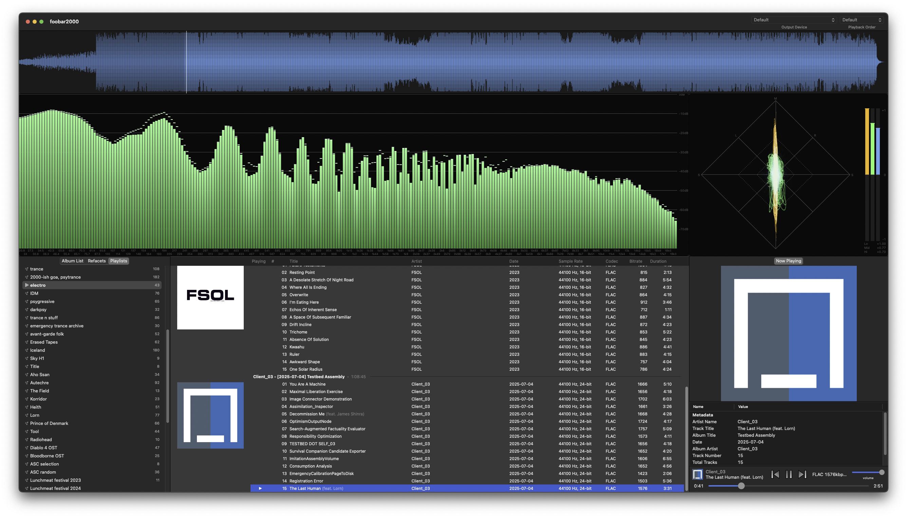
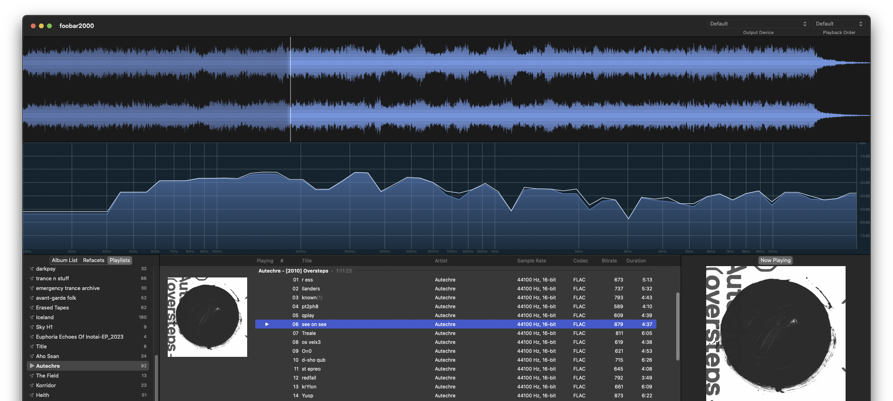
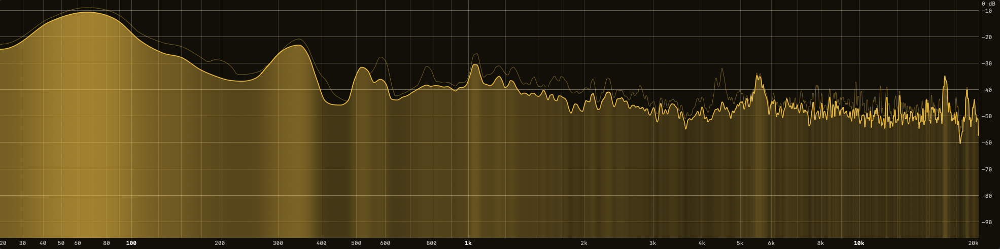
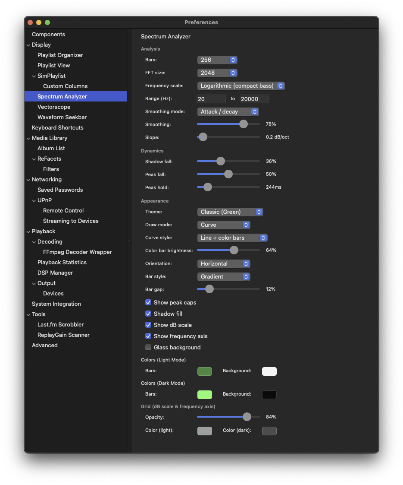

# Spectrum Analyzer

A real-time spectrum analyzer UI element for foobar2000 macOS. Contributed by [Scannou](https://github.com/Scannou).

## Features

### Real-Time FFT Bars

Frequency bars driven by the core `visualisation_manager` stream, updated once per display frame. No third-party DSP; the core's normalized FFT (Gauss window) is mapped into a configurable number of bars over a 0 dB to -80 dB display window.

At the low end, where several log-scale bands fall inside a single FFT bin, each band is sampled at its centre frequency (interpolated between neighbouring bins) instead of all reading the same bin as flat steps.

### Draw Modes

| Mode | Description |
|------|-------------|
| **Bars** | Discrete frequency bars with configurable gap and fill style |
| **Curve** | Smooth curve spanning the full plot width, in one of four curve styles |

The curve uses monotone cubic interpolation (Steffen), so it never overshoots between bands: peaks stay where the data puts them and the curve stays inside the 0..1 range.



### Curve Styles

Curve mode can be drawn four ways:

| Style | Description |
|-------|-------------|
| **Filled** | Stroked line over a gradient-filled area |
| **Line** | Stroked line only |
| **Color bars** | Stripes over the full height of the plot, more opaque where a frequency is louder; no line |
| **Line + color bars** | Stroked line, with the stripes filling only the area under it |

Color bars use the peak-line color, so dominant frequencies stand out at a glance while mid-level bands stay visible. **Color bar brightness** sets how strong the loudest stripe gets. The shadow fill is not drawn in the two color-bar styles, and the peak line is not drawn in **Color bars**.

Filled:



Line + color bars:



### Frequency Scales

| Scale | Description |
|-------|-------------|
| **Logarithmic** | Equal width per octave |
| **Linear** | Equal width per Hz |
| **Logarithmic (compact bass)** | `log10(1 + f/50)`: logarithmic in the highs and close to linear below about 50 Hz, so the bottom octaves take far less width than on a pure log axis |

Bars, gridlines, labels and the frequency readout all follow the selected scale.

### Smoothing Modes

| Mode | Description |
|------|-------------|
| **Attack / decay** | Fast rise and slower fall, applied to the displayed dB value |
| **RMS average** | Running average of signal power per FFT bin; levels rise and fall at one even rate, like a real-time analyzer |

In **RMS average** the Smoothing slider sets the averaging time (0-500 ms, in 5 ms steps) and its label shows milliseconds. Each mode keeps its own Smoothing value, so switching modes does not carry an amount over that means something else in the other mode. Settings from 0.3.0, where RMS used the shared value at 2 ms per step, carry over until the slider is moved.

### Spectral Slope

**Slope** tilts the displayed spectrum around 1 kHz by 0 to 6 dB per octave, so high frequencies read higher and bass lower. Music usually falls off towards the highs; a slope flattens the display so detail there is easier to see. The dB scale then shows sloped levels, not true ones.

### Full Screen

Double-click the panel, or right-click and choose **Full Screen**, to open the spectrum in its own full-screen Space on the same display. It uses the same settings as the panel. Leave with Esc, a double-click, or **Exit Full Screen** in the context menu. The panel pauses while it is fully covered.

### Orientation

Horizontal (frequency along X, magnitude grows up) or vertical (frequency along Y, magnitude grows sideways). The dB scale and frequency axis follow the orientation.

### Three-Layer Dynamics

Each bar has three layers that rise instantly and fall at different rates:

| Layer | Behavior |
|-------|----------|
| **Bar** | Current level, smoothed by the selected smoothing mode |
| **Shadow** | Dim fill behind the bar that eases down at a steady medium rate; in RMS average its fall is scaled to the curve's own fall rate, so it always trails the curve |
| **Peak** | Thin cap that holds for a configurable time, then falls at a steady dB/s rate |

The defaults follow common metering practice: the curve uses RMS averaging at 125 ms (the IEC 61672 "Fast" time weighting used by real-time analyzers, falling up to about 35 dB/s), and the peak line holds for 1 s and then falls 12 dB/s (close to the digital peak meter return of 20 dB in 1.7 s in IEC 60268-18). The curve shows what is playing now; the slower peak line above it shows how loud each band just was. Peak fall settings from 0.3.0 (a 0-100 accelerating speed) convert to the steady rate that covers the first 20 dB in the same time.

### Bar Styles

| Style | Description |
|-------|-------------|
| **Solid** | Single bar color |
| **Gradient** | Vertical gradient from a darkened to a lightened bar color |
| **Spectrum** | Hue mapped across frequency (low to high) |

### Grid

- **dB scale**: guide lines every 10 dB with labels, positioned against the same 0..-80 dB window the bars use
- **Frequency axis**: on both logarithmic scales, gridlines at 1..9 x 10^n Hz, with extra ticks where there is room (filling 10-20 kHz) and de-cluttered labels; the linear scale uses round steps
- **Per-bar labels**: in Bars mode each bar is labelled with its centre frequency, on one or two staggered rows depending on density
- Both auto-hide when the view is too small; color and opacity are configurable (0% hides the grid)

### Color Themes

Ten presets stamp bar, background, and grid colors for both light and dark appearance at once: Default (Blue), Classic (Green), Nord, Dracula, Gruvbox, Solarized, Tokyo Night, Catppuccin, Monokai, Sunset. Editing any color well switches the theme selector to Custom.

### Glass Background

Optional translucent behind-window blur instead of a solid background color (same effect as SimPlaylist and Waveform Seekbar).

### Frequency Readout

Click and hold the left mouse button to show a marker and the exact frequency under the cursor; drag to scrub.

### Dark Mode Support

Separate bar, background, and grid colors for light and dark appearance; the view redraws on appearance change.

## Configuration

Access settings via **Preferences > Display > Spectrum Analyzer**, or right-click the element and choose **Preferences...**. Changes apply live.



### Analysis

| Setting | Description | Range | Default |
|---------|-------------|-------|---------|
| Bars | Number of frequency bars; Auto draws one bar per 2 points of panel width (up to 2048) | Auto, 16, 24, 32, 48, 64, 96, 128, 192, 256, 384, 512 | 96 |
| FFT size | FFT window length | 1024, 2048, 4096, 8192, 16384 | 2048 |
| Frequency scale | Band mapping | Logarithmic, Linear, Logarithmic (compact bass) | Logarithmic (compact bass) |
| Range (Hz) | Lowest and highest displayed frequency | 10-2000 to 1000-24000 | 20 to 20000 |
| Smoothing mode | How levels are smoothed over time | Attack / decay, RMS average | RMS average |
| Smoothing | Attack / decay: temporal smoothing (higher = smoother). RMS average: the averaging time. Stored per mode | 0-100 / 0-500 ms | 82 / 125 ms |
| Slope | Tilt around 1 kHz, in 0.1 steps | 0-6 dB/octave | 0.4 |

### Dynamics

| Setting | Description | Range | Default |
|---------|-------------|-------|---------|
| Shadow fall | How fast the shadow band falls; disabled while the shadow is not drawn | 0-100 | 74 |
| Peak fall | How fast the peak line falls after its hold | 1-60 dB/s | 12 dB/s |
| Peak hold | How long the peak line stays before falling | 0-2000 ms | 1000 ms |

### Appearance

| Setting | Description | Default |
|---------|-------------|---------|
| Theme | Color preset (Custom + 10 presets) | Default (Blue) |
| Draw mode | Bars or Curve | Curve |
| Curve style | Filled, Line, Color bars, Line + color bars (Curve mode only) | Line + color bars |
| Color bar brightness | Strength of the loudest color bar, 10-100% (color-bar styles only) | 64% |
| Orientation | Horizontal or Vertical | Horizontal |
| Bar style | Solid, Gradient, Spectrum | Gradient |
| Bar gap | Gap between bars, % of slot width | 12% |
| Show peak caps | Falling peak line | On |
| Shadow fill | Slow-decaying dim fill behind bars; not drawn (and disabled) in the color-bar curve styles | On |
| Show dB scale | dB guide lines and labels | On |
| Show frequency axis | Frequency gridlines and labels | On |
| Glass background | Translucent blur instead of solid color | Off |
| Colors (Light / Dark) | Bar and background color per appearance | Blue on gray / lighter blue on near-black |

### Grid

| Setting | Description | Default |
|---------|-------------|---------|
| Opacity | Grid line and label opacity (0% hides) | 84% |
| Color (light / dark) | Grid color per appearance | Neutral gray |

## Layout Editor

Add Spectrum Analyzer to your layout using any of these names:
- `spectrum` (recommended)
- `Spectrum Analyzer`
- `spectrum_analyzer`
- `foo_jl_spectrum`
- `jl_spectrum`

Example layout:
```
splitter vertical
  waveform-seekbar
  spectrum
  simplaylist
```

## Technical Details

### Audio Analysis

- `visualisation_stream_v2::get_spectrum_absolute` with `KStreamFlagNewFFT`, mono channel mode
- Band edges recomputed when the stream's sample rate changes; the DC bin is skipped
- Peak magnitude across each band's bins (reads punchier than the average)
- RMS average keeps a one-pole average of power for every FFT bin and reads the bars off the averaged spectrum. With nothing coming in, the curve falls at most `10 x log10(e) / tau` dB/s (about 35 dB/s at 125 ms); the shadow fall slider maps to 15-90% of that rate
- The slope is a per-bar gain of `slope x log2(f / 1 kHz)` dB at the bar's centre frequency
- Rates for smoothing, shadow fall, peak fall, and peak hold are defined per 1/60 s and scaled by the time since the previous update, so motion is the same at any refresh rate

### Rendering

- Core Graphics (Quartz 2D), layer-backed view
- On macOS 14 and later, updates come from the view's `CADisplayLink`, in step with the screen's refresh; on fast displays every second or third refresh is used (60-90 fps). macOS 12-13 uses a 60 fps `NSTimer` on the main run loop (common modes)
- Redraws only while audio is live or bars are still settling, and not while the window is fully covered
- Color bars are a single gradient along the frequency axis with a stop at each band centre
- Stream released when the view goes off-screen; recreated lazily on the next tick (a fresh stream returns no data for its first reads, so it is not released per idle frame)

### Lifecycle

- An `initquit` service stops every live view's updates and releases its stream before the core tears down the visualisation backend; holding a stream through shutdown throws `exception_service_not_found` and aborts
- Settings persist via `fb2k::configStore` under the `foo_jl_spectrum.` prefix (cfg_var does not persist on macOS v2)

## Requirements

- foobar2000 v2.x for macOS
- macOS 12.0 (Monterey) or later

## Links

- [Main Project](../README.md)
- [Changelog](../extensions/foo_jl_spectrum_mac/CHANGELOG.md)
- [Build Instructions](../extensions/foo_jl_spectrum_mac/README.md)
