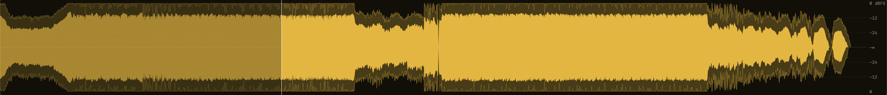
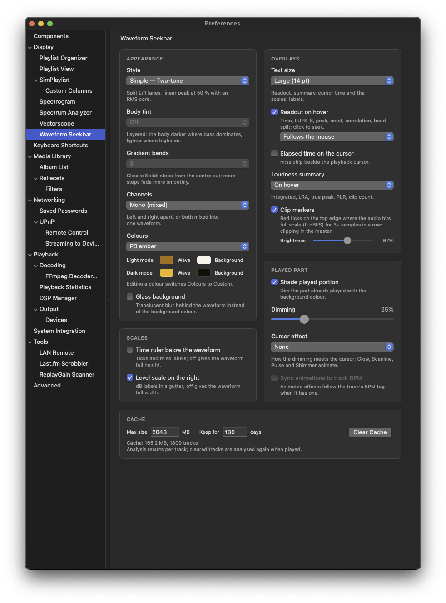

# Waveform Seekbar

An interactive waveform display and seekbar for foobar2000 macOS.

## Features

### Complete Waveform Display

Shows the entire track waveform at a glance - not just the current audio buffer. See the full structure of your music including quiet intros, build-ups, and loud sections.

<!-- Screenshot: Waveform overview -->


### Interactive Seeking

Click anywhere on the waveform to seek to that position. The playback cursor carries an optional elapsed-time chip.

### Styles

| Style | Description |
|-------|-------------|
| **Layered** | L up, R down on one dBFS axis: the peak envelope around a momentary (400 ms) loudness body. The gap between them is the crest factor, so compression is visible. The body is tinted by each passage's spectral balance: darker where bass dominates, brighter where highs do. |
| **Two-tone** (default) | Split L/R lanes on black, linear: peaks at 50 % with an RMS core |
| **Glow** | Peaks fade to the tips, RMS core runs to a hot centre |
| **Heat** | One layer coloured by amplitude, deep to hot |
| **Heat map** (classic) | Each column coloured by its peak, blue → green → yellow → red |
| **Rainbow** (classic) | Hue runs through the rainbow across the track |
| **Solid** (classic) | The theme colour fading from the centre out in steps (Gradient bands: none to 32) |

Every style can show **Stereo** (L and R apart) or **Mono** (both mixed into one).

### Loudness Analysis

Each track is analysed once and cached: BS.1770-4 integrated loudness, EBU Tech 3342 loudness range, 4x oversampled true peak, PLR, clip runs, per-moment short-term loudness, correlation and Lo/Mid/Hi energy.

- **Readout on hover**: time, LUFS-S, peak, crest, correlation and band split under the mouse; next to the mouse, top right, or bottom right above the summary
- **Loudness summary**: `I −12.4 LUFS  LRA 15.9 LU  TP +0.4 dBTP  PLR 12.8  17 clips` (off, on hover or always)
- **Clip markers**: red ticks on the top edge where the audio hits full scale (0 dBFS) for 3+ samples in a row, i.e. clipping in the master; adjustable brightness

### Scales

Optional time ruler under the waveform and a dB gutter on the right.

### Played Part

The part already played can be dimmed (default 25 %), with a cursor effect at its edge: None (default), Gradient, Glow, Scanline, Pulse, Trail or Shimmer. The animated ones can follow the track's BPM tag.

### Waveform Caching

SQLite-based cache stores analyzed waveforms for instant loading:
- SHA-256 hash keys for reliable file identification
- Configurable cache size (default: 2GB)
- Automatic LRU eviction when limit reached
- WAL mode for concurrent access

### Colours

Theme presets shared with Spectrum Analyzer (P31 / P3 / P4 / P7 phosphors, Nord, Dracula, ...) or custom light / dark colours. Darker and brighter shades for gradients are derived from the theme in OKLCH.

### Dark Mode Support

Automatic color adaptation for macOS light and dark appearances.

### Retina Display

Crisp rendering on high-DPI displays using native `backingScaleFactor`.

## Configuration

Access settings via **Preferences > Display > Waveform Seekbar**

<!-- Screenshot: Settings panel -->


### Available Settings

| Card | Setting | Default |
|------|---------|---------|
| Appearance | Style, Body tint, Gradient bands, Channels, Colours, Glass background | Two-tone, off, 8, Stereo, P4 white, off |
| Scales | Time ruler, Level scale | off, on |
| Overlays | Text size, Readout on hover, Elapsed time on the cursor, Loudness summary, Clip markers | 14 pt, on, off, on hover, on (67 %) |
| Played part | Shade played portion, Dimming, Cursor effect, Sync animations to track BPM | on, 25 %, None, off |
| Cache | Max size, Keep for | 2048 MB, 180 days |

### Cache Location

Waveform data is cached at:
```
~/Library/foobar2000-v2/waveform_cache/waveforms.db
```

## Layout Editor

Add Waveform Seekbar to your layout using any of these names:
- `waveform-seekbar` (recommended)
- `Waveform Seekbar`
- `waveform_seekbar`
- `foo_jl_wave_seekbar`

Example layout:
```
splitter vertical
  waveform-seekbar
  simplaylist
```

## Technical Details

### Audio Analysis

- One decode pass per track in the background (Grand Central Dispatch), cancelled on track change
- Fine blocks (~900-1000 frames) of sample min/max/RMS and 100 ms hops of K-weighted power, band power and L*R
- Loudness, true peak and clips cover every channel (BS.1770 weights: surround 1.41, no LFE); the first two are drawn
- Long local tracks decoded in parallel segments on the foobar2000 CPU thread pool
- Per-column values are aggregated from the cached blocks, so resizing never re-decodes

### Rendering

- Core Graphics: layers cached as alpha masks per track and size, coloured per theme
- Frames redraw only the played boundary, cursor and overlays (60 FPS timer)

## Requirements

- foobar2000 v2.x for macOS
- macOS 12.0 (Monterey) or later

## Links

- [Main Project](../README.md)
- [Changelog](../extensions/foo_jl_wave_seekbar_mac/CHANGELOG.md)
- [Build Instructions](../extensions/foo_jl_wave_seekbar_mac/README.md)
