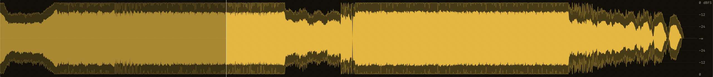
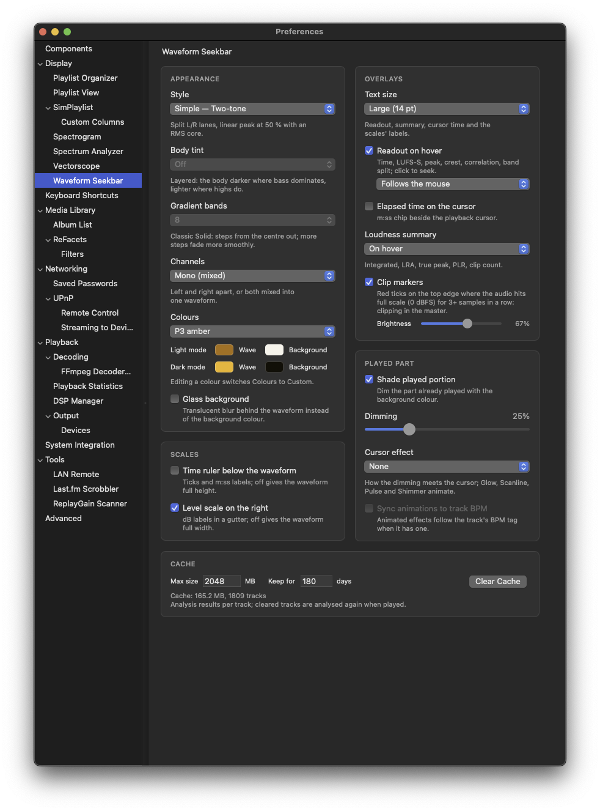

# Waveform Seekbar

An interactive waveform display and seekbar for foobar2000 macOS.

## Features

### Complete Waveform Display

Shows the entire track waveform at a glance - not just the current audio buffer. See the full structure of your music including quiet intros, build-ups, and loud sections.

<!-- Screenshot: Waveform overview -->


### Interactive Seeking

Click anywhere on the waveform to seek to that position. The playback cursor carries an optional elapsed-time chip.

### Zoom

Pinch on the trackpad, or scroll vertically with the mouse wheel or trackpad, to zoom in on the part under the pointer; scroll horizontally (or hold Shift with a wheel) to pan. Clicking seeks within the zoomed part. **Reset zoom** at the bottom right returns to the whole track, and each new track starts unzoomed.

Zoomed in, the view can follow the playback cursor (Preferences > Zoom, or the cog at the bottom right):

- **Don't follow the cursor** (default): the view stays where you put it.
- **Follow the cursor**: while the cursor is in view, the waveform moves under it and the cursor stays where it is (where it came into view). Panning, zooming or a click with the cursor in view sets that spot. While the cursor is out of view the view stays.
- **Reset zoom** also switches following off.
- **Keep the cursor centred**: the cursor stays in the middle; at the track's start and end the view shows empty space beyond it, the only mode that does. Panning does nothing, zooming zooms about the cursor.

Zoom can be switched off in Preferences > Zoom. **Fine detail for deep zoom** (off by default) keeps 7-8x finer detail per track, more for long mixes, so zooming goes that much deeper; it is gathered in the same analysis pass. It costs about 1 MB of cache per track (up to 5 MB for long mixes), and fine detail is the first thing dropped when the cache is over its size limit. Tracks analysed before the option was on are analysed again in the background when played; for a stream that means downloading it once more, since its audio is not kept on disk.

### Styles

| Style | Description |
|-------|-------------|
| **Layered** | Each channel mirrored in its own lane on a dBFS axis (one lane in Mono; L up and R down around one centre line in Split): the peak envelope around a momentary (400 ms) loudness body. The gap between them is the crest factor, so compression is visible. The body is tinted by each passage's spectral balance: darker where bass dominates, brighter where highs do. |
| **Two-tone** (default) | Split L/R lanes on black, linear: peaks at 50 % with an RMS core |
| **Glow** | Peaks fade to the tips, RMS core runs to a hot centre |
| **Heat** | One layer coloured by amplitude, deep to hot |
| **Heat map** (classic) | Each column coloured by its peak, blue → green → yellow → red |
| **Rainbow** (classic) | Hue runs through the rainbow across the track |
| **Solid** (classic) | The theme colour fading from the centre out in steps (Gradient bands: none to 32) |

Every style can show **Stereo** (L and R apart) or **Mono** (both mixed into one). **Split** draws L above and R below one centre line, each at twice the height of a Stereo lane: Layered and Classic up to each channel's peak, Simple with each channel's larger excursion and its core.

### Controls (the cog)

Hovering the waveform shows a cog at the bottom right. Its menu picks the controls (also in Preferences > Overlays, "Controls on hover") and the zoom's follow mode:

- **No controls** (default): only the cog; clicks seek.
- **Mixer**: beat jumps and loops (below); needs BPM Analyzer.
- **Analytics**: the hover readout and the loudness summary, as their preferences set them.

### Loudness Analysis

Each track is analysed once and cached: BS.1770-4 integrated loudness, EBU Tech 3342 loudness range, 4x oversampled true peak, PLR, clip runs, per-moment short-term loudness, correlation and Lo/Mid/Hi energy. The readout and the summary show with the **Analytics** controls.

- **Readout on hover**: time, LUFS-S, peak, crest, correlation and band split under the mouse; next to the mouse, top right, or bottom right above the summary
- **Loudness summary**: `I −12.4 LUFS  LRA 15.9 LU  TP +0.4 dBTP  PLR 12.8  17 clips` (off, on hover or always)
- **Clip markers**: red ticks on the top edge where the audio hits full scale (0 dBFS) for 3+ samples in a row, i.e. clipping in the master; adjustable brightness

### Phrase Markers

With [BPM Analyzer](bpm.md) installed (it finds each track's beat grid), a hairline every 16 or 32 beats, where the music's phrases start. Off by default.

| Marker | Meaning |
|--------|---------|
| Quiet line | Locked: the beats sit on the grid (within 10 ms) |
| Amber line + bottom tick | Drifting: 10-25 ms off, or fewer of the beats heard on the grid (a beat the music leaves out, as in a sparse build-up, does not count against it) |
| Red line + bottom tick | Broken: the music has left the grid here |
| Dashed, dim | No pulse: no beat to judge by (intro, breakdown) |
| Triangle on the top edge | A new grid begins: a tempo change or an edit |

- **Follow tempo changes** (on by default): after a new grid the markers move to it, on its own tempo, and count phrases from there; off keeps them on the track's main grid. Beat-synced cursor effects follow the same grid.
- Hovering a marker adds a line to the readout (`Phrase 12 · bar 45 · +18 ms`, `New grid · 141.64 BPM`); the summary shows the grid tempo and the share of Locked phrases. Markers thin out (every 64, 128 beats...) where they would crowd, and say so in the readout.
- Without BPM Analyzer (or with one older than 0.1.0) the settings are greyed out and offer **Install BPM Analyzer...**: it looks up the newest BPM Analyzer release on GitHub, shows its version, size and where it will go, and on confirmation downloads it, checks it against the release's SHA-256 checksum, installs it to `user-components/foo_jl_bpm` and offers a restart. After the restart the phrase markers are switched on and the preferences reopen. Nothing is downloaded without the click.

### Beat Jumps and Loops

With the **Mixer** controls (the cog; needs BPM Analyzer), the bottom bar shows on hover:

| Control | Does |
|---------|------|
| `‹32` `‹16` / `16›` `32›` | Jump 16 or 32 beats back or on (with Option while looping: move the whole loop) |
| `‹` `4▾` `›` | Jump the chosen size back or on; the menu sets the size (1 to 32 beats) for these and the loop |
| `Loop` | Loop that many beats from the beat behind the cursor, or from a 16-beat phrase start near it; click again to stop |

- Jumps keep the playback position's place within its beat, count beats on the grid that holds there (following a new grid when Follow tempo changes is on), stop at the start going back and do nothing when they would reach the end.
- **Phrase starts**: asked for up to 4 beats after a 16-beat phrase start (16 and 32-beat loops; 2 for 8, 1 for shorter) or a beat before it, the loop starts on the phrase.
- A loop starts playing from its first beat and is drawn in green. While it plays, a jump moves playback (inside the loop, or out of it, which ends it); **Option** with a jump, or **Option-drag** on the waveform (applied on release), moves the whole loop by whole beats. A new size keeps its start, and a click outside the loop (or a seek from elsewhere) ends it. A new track ends it too.
- A narrower size applies at once: playback past the new end goes back into the loop, as far in as it was past a multiple of the new length (bar 5 of 8, narrowed to 4: bar 1). A wider one plays on past the old end in the same pass.
- A click within 6 points of a beat plays from that beat.
- **Without a gap or a click**: choosing the Mixer adds a "Beat loop (Waveform Seekbar)" DSP first in the playback chain (Preferences > Playback > DSP; leaving the Mixer removes it). It keeps the track's last 40 s and the audio decoded ahead; loops, new sizes, loop moves and jumps back are splices inside that audio with a 5 ms crossfade, not seeks (every seek flushes foobar2000's output, which is a gap). A forward jump without a loop still seeks: that audio is not decoded yet.
- **Delay**: a change is heard after foobar2000's output buffer. While the mixer is on, the seekbar sets that buffer to 100 ms (Preferences > Overlays, "Output buffer with the mixer": Unchanged, 50-200 ms) and puts your own back when the mixer goes off, or at the next launch if foobar2000 quit in between; playback restarts once at each switch. While the mouse is over the seekbar the DSP also sends short steps (otherwise 1 s steps keep the decoder from running far ahead; after 300 s of decoded audio waiting, a loop ends). The console says once how long a change takes.
- While the DSP plays from its buffer (a loop, or after a jump back until it catches up), foobar2000's own time display may lag or stand still; the seekbar's cursor follows what plays. Without the DSP in the chain, loops run by seeking, with a short gap at each start.

### Scales

Optional time ruler under the waveform and a dB gutter on the right.

### Played Part

The part already played can be dimmed (default 25 %), with a cursor effect at its edge: None (default), Gradient, Glow, Scanline, Pulse, Trail or Shimmer. The animated ones can follow the track's beat grid (from BPM Analyzer) or its BPM tag.

### Waveform Caching

SQLite-based cache stores analyzed waveforms for instant loading:
- SHA-256 hash keys for reliable file identification
- Configurable cache size (default: 2GB)
- Automatic LRU eviction when limit reached
- WAL mode for concurrent access

### Colours

Theme presets shared with Spectrum Analyzer (P31 / P3 / P4 / P7 phosphors, Nord, Dracula, ...) or custom light / dark colours. Darker and brighter shades for gradients are derived from the theme in OKLCH.

### Dark Mode Support

Automatic color adaptation for macOS light and dark appearances.

### Retina Display

Crisp rendering on high-DPI displays using native `backingScaleFactor`.

## Configuration

Access settings via **Preferences > Display > Waveform Seekbar**

<!-- Screenshot: Settings panel -->


### Available Settings

| Card | Setting | Default |
|------|---------|---------|
| Appearance | Style, Body tint, Gradient bands, Channels, Colours, Glass background | Two-tone, off, 8, Stereo, P4 white, off |
| Scales | Time ruler, Level scale | off, on |
| Overlays | Text size, Readout on hover, Elapsed time on the cursor, Loudness summary, Clip markers | 14 pt, on, off, on hover, on (67 %) |
| Overlays | Phrase markers (every 32 or 16 beats, Colour grid breaks, Follow tempo changes) | off (32, on, on) |
| Played part | Shade played portion, Dimming, Cursor effect, Sync animations to track BPM | on, 25 %, None, off |
| Cache | Max size, Keep for | 2048 MB, 180 days |

### Cache Location

Waveform data is cached at:
```
~/Library/foobar2000-v2/waveform_cache/waveforms.db
```

## Layout Editor

Right-click the seekbar for **Lock Width** and **Lock Height**. With **Locked size follows the screen** (Preferences > Appearance, on by default) a locked size is kept as a share of the screen, so it stays in proportion when the window moves to another display or the resolution changes; off keeps it in points.

Open **View → Layout → Edit Layout...**, add a line with one of these names where you want the panel, and click **Apply**:
- `waveform-seekbar` (recommended)
- `Waveform Seekbar`
- `waveform_seekbar`
- `foo_jl_wave_seekbar`

Example layout:
```
splitter horizontal style=thin
  waveform-seekbar
  simplaylist
```

## Technical Details

### Audio Analysis

- One decode pass per track in the background (Grand Central Dispatch), cancelled on track change
- Fine blocks (~900-1000 frames) of sample min/max/RMS and 100 ms hops of K-weighted power, band power and L*R
- Loudness, true peak and clips cover every channel (BS.1770 weights: surround 1.41, no LFE); the first two are drawn
- Long local tracks decoded in parallel segments on the foobar2000 CPU thread pool
- Per-column values are aggregated from the cached blocks, so resizing never re-decodes

### Rendering

- Core Graphics: layers cached as alpha masks per track and size, coloured per theme
- Frames redraw only the played boundary, cursor and overlays (60 FPS timer)

## Requirements

- foobar2000 v2.x for macOS
- macOS 12.0 (Monterey) or later

## Links

- [Main Project](../README.md)
- [Changelog](../extensions/foo_jl_wave_seekbar_mac/CHANGELOG.md)
- [Build Instructions](../extensions/foo_jl_wave_seekbar_mac/README.md)
