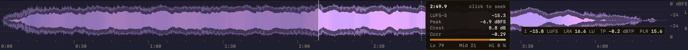

# Changelog

All notable changes to Waveform Seekbar will be documented in this file.

## [Unreleased]

### Added
- **Zoom**: Pinch, mouse wheel or vertical trackpad scroll zooms the waveform about the pointer; horizontal scroll (or Shift + wheel) pans. A Reset zoom button appears bottom right while zoomed; a new track starts unzoomed.

- **Zoom settings**: Zoom can be switched off; "Fine detail for deep zoom" (off by default) keeps 7-8x finer detail per track, more for long mixes, and zooms that much deeper (about 1 MB of cache per track).

- **Phrase markers**: With BPM Analyzer installed, a line every 16 or 32 beats coloured by how well the music stays on one beat grid (drifting, broken, no pulse, new grid); readout line near a marker, grid BPM and locked share in the summary. Off by default.

- **Follow tempo changes**: Where a new grid begins (a tempo change, an edit), phrase markers and beat-synced effects move to it and count phrases from there; can be switched off.

- **Install BPM Analyzer**: Without BPM Analyzer (or with one too old), the phrase marker settings offer to install it: the newest release is downloaded from GitHub, checked against its SHA-256 checksum and installed; after the restart the markers are switched on and the preferences reopen.

- **Bottom bar controls**: A cog at the bottom right on hover picks no controls (default), the mixer, or analytics (the readout and loudness summary, now shown only there); also in Preferences > Overlays.

- **Beat jumps and loops**: With the mixer and BPM Analyzer, jump 16, 32 or the chosen 1-32 beats back or on (keeping the place in the beat), loop the chosen beats from the beat behind the cursor (formed around what plays, drawn in green), and with Snap clicks jump at once to the nearest beat, keeping the beat.

- **Snap**: Mixer bar toggle (on by default): clicks and drags go to the nearest beat at the same place in the beat as what plays, so the beat goes on without a delay, and hovering shows that beat with its time; off, clicks go exactly where clicked.

- **Trusted grid sections**: Beats, jumps, loops and beat-synced effects use the track's main grid where a section doesn't fit its own bars or runs at a multiple of the tempo; phrase markers still show every section.

- **Decode-ahead reserve**: With a beat grid, the mixer's DSP keeps 32 beats (at least 20 s) decoded ahead, built at 8x the decoder's pace (as on hover), and the mixer's own seeks start 32 beats early, so jumps forward and back after a seek play without another; it drains in the track's last minute.

- **Seek notes in the console**: A jump, click or loop that still has to seek says so, with the audio the DSP held; such a seek lands where the beat would be once heard (the seek's gap and the pre-roll's time are measured); jumps no longer seek at a track started by hand.

- **Gapless loops**: The mixer adds a "Beat loop" DSP first in the playback chain; loops, new sizes, loop moves and jumps are crossfaded splices in its buffered audio instead of seeks, so they play without a gap or a click. A narrower loop applies at once (playback wraps into it); a wider one plays on.

- **Option-drag, Option-jump**: Move the whole loop by whole beats; a plain jump while looping moves playback. The loop stays set until switched off: playback outside it plays on, playback before it is caught when it comes in.

- **Mixer output buffer**: While the mixer is on, foobar2000's output buffer is set to 100 ms (or 50-200 ms, or left alone), so loop and jump changes are heard at once; the user's own value comes back when the mixer goes off.

- **Phrase-aware loops**: A loop asked for just after (or a beat before) a 16-beat phrase start starts on the phrase.

- **Following the cursor**: Zoomed in, the view can follow the cursor at a spot you set by panning, or keep it centred (the only mode showing space beyond the track's ends); in the cog's menu and Preferences > Zoom. With the mixer, clicks and beat jumps keep the spot once the jump is heard.

- **Locked size follows the screen**: Lock Width and Lock Height keep their share of the screen on another display or resolution (on by default).

- **Particles cursor effect (experimental)**: Sparks burst off the waveform at the cursor, more where the track is louder, so they follow its beat.

- **Firewall cursor effect (experimental)**: A wall of flames stands on the cursor, taller where the track is loud; the played part keeps burning behind it as a row of fires, each as tall as the track is loud there.

- **Earthcrusher cursor effect (experimental)**: A jagged, glowing cursor leaves the waveform just behind it scorched and cracked, in burnt shades of the wave colour.

### Changed
- **Glow cursor effect**: Now a bloom centred on the cursor line, fading with distance and pulsing on the beat.

- **Trail cursor effect**: Removed; a saved Trail setting now shows as Gradient.

- **Redraw speed**: Zooming, resizing and track changes redraw the waveform 3-10x faster (Layered at 3000 px: 23-53 ms to 7-17 ms per frame); edges are antialiased more exactly.

- **BPM sync**: With a beat grid from BPM Analyzer, the Glow, Scanline, Pulse and Shimmer effects follow the playback position and peak on every beat; the BPM tag's tempo is the fallback.

- **Preferences**: Three columns of settings when the preferences window is wide enough.

### Fixed
- **Long streams**: SoundCloud mixes and other long remote tracks no longer end as "No waveform"; the watchdog waited 30 s, restarted the analysis from the beginning, then gave up at 60 s. A running analysis is now waited for.

### Technical
- `trustedGrid` / `sectionFit` (`PhraseMarkers.h`): a section fits with at least 8 bars within 15 ms and 3 in 4 heard beats matched (half of those judged) and a tempo 0.45-2.25x the master's; unit-tested on two real grids.
- `LoopEngine`: opt-in decode-ahead reserve (`setReserveSeconds`), requests turned down across a track change, and one target resolution for Jump and Loop (by, in phase, absolute; a seek's own then from its `to`); unit-tested.
- `LoopEngine.h`: the gapless loop's audio side (record, repeat, hold the decoded audio, leave without a break) and the timeline that maps output frames to track time, unit-tested with frame-numbered audio. `ZoomRange` gains following and centring on whole pixels; while following, masks cover a view's width more on each side and draw at whole-pixel offsets.
- `BeatJump.h`: the grid's beats (master or section by section), beat numbers, jumps, loops and the loop's step at each position check, unit-tested.
- `ZoomRange` (zoom about a point, pan, x to track position) and `aggregateColumns` over a part of the track, unit-tested; a range's columns equal the matching slice of the whole track's.
- Mask shapes (`MaskPaths.h`) filled in runs of 32 columns, edges and Classic strokes stroked in runs; unit-tested against the exact pixel coverage.
- A request for the track already being scanned no longer restarts the scan (second seekbar, layout change, watchdog).
- Fine detail: blocks of about 128 frames (a divisor of the normal block, at most 2^19 per track) gathered in the same pass, segments included; stored in their own cache table (the waveform format stays version 3), evicted first over the size limit; columns narrower than a normal block take their envelope from them. Unit-tested: block values, nesting, segment joins, round trip, a single-sample transient's column.

## [2.0.0] - 2026-10-30

The redesign and the Display P3 colours were contributed by @Scannou (#49, #55).

### Added
- **Layered style**: Each channel's peak envelope around its momentary (400 ms) loudness body on a dBFS axis; the gap between them shows the crest factor. Body tint (off, subtle, strong) shades it by the passage's spectral balance.
- **Simple styles**: Two-tone, Glow and Heat draw L and R in lanes on black, on a linear scale, with an RMS core inside the peaks.
- **Split channels**: Third Channels mode for every style: L above and R below one centre line, each at twice a Stereo lane's height.
- **Loudness analysis**: BS.1770-4 integrated loudness, EBU 3342 loudness range, 4x oversampled true peak, PLR, clip runs, correlation and Lo/Mid/Hi energy per track, over every channel (surround weighted, LFE left out).
- **Hover readout**: Time, short-term loudness, peak, crest, correlation and band split under the mouse; beside the mouse or in a corner.
- **Loudness summary**: Integrated loudness, LRA, true peak, PLR and clip count in a badge; off, on hover or always.
- **Clip markers**: Red ticks on the top edge where the audio stays at full scale for 3 or more samples; adjustable brightness.
- **Scales**: Optional time ruler under the waveform and dB level scale on the right.
- **Elapsed time**: Optional m:ss chip beside the playback cursor.
- **Colour themes**: Presets shared with Spectrum Analyzer (P31, P3, P4 and P7 phosphors, Nord, Dracula and more); darker and brighter shades derived in OKLCH.
- **Text size**: One setting for the overlay and scale text.
- **Component details**: A "?" button next to the preferences title shows the component file, version and layout element names, ready to copy.*

### Changed
- **Defaults**: Two-tone in P4 white, level scale, readout and clip markers on, summary on hover, 25 % played-part dimming, no cursor effect; settings that were never changed take them too.
- **Display P3 colours**: Theme and custom colours are drawn in Display P3, so they show at full saturation on wide-gamut screens; stored colours are kept, so they look more saturated than before.
- **Drawing**: Smooth per-pixel-column waveform from cached masks; theme changes recolour without redrawing the shape. The waveform sits 8 pt inside the top and bottom edges.
- **Classic styles**: Solid, Heat map and Rainbow stay as the original styles.
- **Playback cursor**: Drawn in the theme's cursor colour within the waveform area (was a white line over the full height); seeking maps across the waveform area, and the level scale does not seek.
- **Cache**: Stores the fine-grained analysis with the loudness data, so entries are 10-20x larger; every track is analysed again once after the update.
- **Preferences**: Appearance, Scales, Overlays, Played part and Cache cards with a hint under each control; the page scrolls.
- **Parallel analysis**: Long local tracks are analysed in parallel segments on the foobar2000 CPU thread pool (thanks @alies-dev, #40).*
- **Minimum macOS**: Raised to 12.0 (Monterey).*
- **About**: New feature list; shows the layout element name (`waveform-seekbar`) and the preferences path; the copyright notice is replaced by the MIT license line.*
- **Preferences title**: Same size as foobar2000's own page titles.*

### Fixed
- **Played-part dimming**: Matches the background colour exactly; it was rebuilt from device components, a slight shift.
- **Analyzing state**: No longer stuck on "Analyzing..." after a layout change; a 30 s watchdog retries once, then gives up.*
- **Scan cancellation**: Skipping tracks stops the previous track's analysis instead of leaving it running.*
- **Colour drift**: Colours no longer get one step darker on each preferences save and reload.*

### Technical
- One decode pass per track (`TrackAnalyzer`): sample min/max/RMS per block, 100 ms hops of K-weighted power, band power and L*R; parallel segments give a bit-identical result to one pass.
- Cache format v3 (zlib): samples stored up to +6 dBFS, plus the all-channel loudness sum.
- Per-column values are aggregated from the cached blocks (`ColumnAggregator`), so resizing never re-decodes.
- C++ moved under the `waveseek::` namespace; theme colour helpers shared in `shared/ThemeColor.h`.
- 9 unit-test suites gate the build, including exact segment equality, 5.1 loudness, true peak at the track end and cache headroom.

\* Developed as 1.2.1, which was never published.

## [1.2.1] - developed 2026-10-19, never published (ships in 2.0.0)

### Added
- **Component details**: A "?" button next to the preferences title shows the component file, version and layout element names, ready to copy.

### Changed
- **Minimum macOS**: Raised to 12.0 (Monterey).
- **Waveform analysis**: Long tracks decode in parallel segments; a 2 hour MP3 mix is analyzed in ~0.4s instead of ~4s, a 4 minute track in ~0.02s instead of ~0.15s (thanks @alies-dev, #40).
- **About**: Shows the layout element name (`waveform-seekbar`) and the preferences path; the copyright notice is replaced by the MIT license line.
- **Preferences title**: Same size as foobar2000's own page titles.

### Fixed
- **Analyzing state**: The seekbar no longer stays on "Analyzing..." after a layout change; it re-requests the waveform when it reappears, and a 30s watchdog retries once, then gives up.
- **Scan cancellation**: Each scan owns its abort object, so starting a scan no longer clears the abort of the one it replaces (skipping tracks left every earlier decode running); a superseded scan no longer marks the current one finished.
- Colors could drift one step darker each time preferences were saved and reloaded (ARGB conversion truncated instead of rounding)
- `WaveformData` position accessors invoked undefined behaviour on a negative or NaN position; the index is now clamped before the cast

### Technical
- Segments run on the foobar2000 CPU thread pool and seek by absolute sample position, so the result matches a sequential scan exactly; remote, non-seekable and expensive-seek inputs stay sequential, and a segment failure (including a mid-stream sample rate change) falls back to one sequential pass.
- Buckets split the track proportionally; the old fixed bucket size dropped up to 2047 trailing samples.
- Bucket min/max/RMS computed with vDSP; RMS accumulates in double instead of float.
- Peak binning and the segment bucket layout live in `PeakBinner`, so the min/max/RMS math is unit-tested without a decoder or the SDK
- Render geometry and colour ramps extracted into `WaveformGeometry` and `WaveformColorMap`; the four near-duplicate drawing paths in the view collapse to two helpers and `drawRect` only emits Core Graphics calls
- Gradient-band choices now come from one table (`GradientBandTable`) instead of an if/else ladder and a parallel array that could drift apart
- ARGB conversion deduplicated between the view and preferences
- Cache eviction, expiry and key arithmetic extracted into `CachePolicy`, separated from the SQLite statements
- Banded rendering computes each bucket's peak once per trace instead of once per band
- Unit tests (`Tests/`, run by `Scripts/run_tests.sh` under ASan+UBSan) gate the build; ~1s, no SDK or Xcode needed

## [1.2.0] - 2026-07-02

### Added
- Glass background option (Preferences > Display): translucent blur background using the same behind-window effect as SimPlaylist; toggles live without restart
- Background color wells now support transparency (alpha slider in the color panel); a translucent background acts as a tint over the glass blur
- "Preferences..." context menu item that opens the Waveform Seekbar preferences page directly

### Fixed
- Playback cursor updated only ~2x per second on longer tracks; redraw threshold is now pixel-based for smooth movement
- Animated cursor effects (Glow, Scanline, Pulse, Shimmer) now animate continuously instead of only on cursor movement
- Played-portion shading painted the opaque background color over the glass blur; it now uses a neutral translucent dim in glass mode
- Stale waveform scans no longer overwrite the current track's data on rapid track changes (generation counter)
- Race between concurrent cache store and lookup resolved (double-check under lock)
- Per-controller waveform listener removal; seekbar recovers cleanly when layout elements are recreated

### Technical
- SQLite cache uses prepared statements for all queries
- Construct-on-first-use singletons avoid static initialization order issues
- Listener callbacks invoked outside the lock to prevent deadlocks
- Position updates driven solely by the 60fps timer; removed redundant playback-time dispatch and verbose config logging

## [1.1.0] - 2025-12-29

### Added
- Context menu with right-click on waveform seekbar
- "Lock Width" option to prevent horizontal resizing
- "Lock Height" option to prevent vertical resizing
- Lock settings persist across application restarts

## [1.0.0] - 2025-12-28

### Added
- Initial release
- Complete waveform display with 2048 buckets per track
- Click-to-seek functionality
- Stereo and mono display modes
- Waveform styles: Solid (with gradient bands), HeatMap, Rainbow
- Cursor effects: None, Gradient, Glow, Scanline, Pulse, Trail, Shimmer
- BPM sync for cursor animations from ID3 tags
- Dark mode support with automatic appearance switching
- SQLite waveform cache with zlib compression
- Configurable cache size and retention
- Preferences panel for all settings
