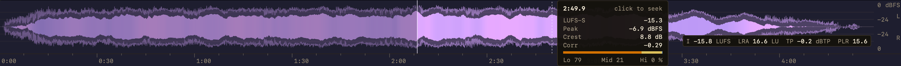
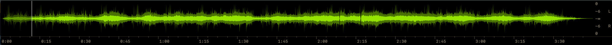
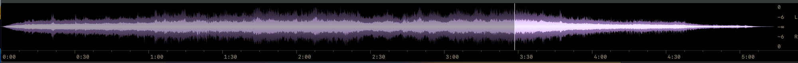
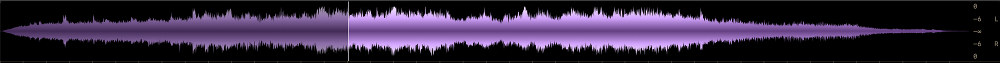
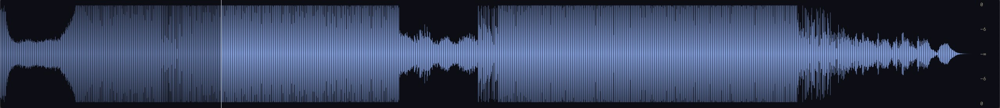

# foo_jl_wave_seekbar

> Part of [foobar2000 macOS Components Suite](../../README.md)

**[Features & Documentation](../../docs/waveform.md)** | **[Changelog](CHANGELOG.md)**

---

An interactive waveform display and seekbar for foobar2000 macOS.

## Screenshots











## Requirements

- foobar2000 for Mac 2.x
- macOS 12.0+ (Monterey or later)
- Xcode 15+ with Command Line Tools (for building from source)
- Ruby (for project generation)

## Quick Start

### Build and Install

```bash
# From this directory
./Scripts/build.sh --install            # Run tests, build Release and install
./Scripts/build.sh --clean --install    # Clean rebuild and install
./Scripts/build.sh --regenerate --install  # After adding/removing source files

# Restart foobar2000, then add the UI element
```

### From Binary

1. Download `foo_jl_wave_seekbar.fb2k-component` from [Releases](https://github.com/JendaT/fb2k-components-mac-suite/releases?q=waveform)
2. In foobar2000, open **Preferences** (⌘,) **→ Components**, click **+** and choose the file
3. Restart foobar2000 when it asks

## Build Scripts

All scripts are located in the `Scripts/` directory and share `shared/scripts/lib.sh`.

| Script | Purpose |
|--------|---------|
| `build.sh` | Run tests, then build (`--debug`, `--release`, `--clean`, `--regenerate`, `--install`) |
| `run_tests.sh` | Compile and run the Core unit tests standalone |
| `install.sh` | Install a pre-built component (`--config Debug`) |
| `clean.sh` | Remove the build directory and the generated Xcode project |
| `generate_xcode_project.rb` | Generate the Xcode project from `src/` |

Never call `xcodebuild` directly; `build.sh` keeps output in the local `build/` directory so `install.sh` copies the binary you just built.

## Usage

### Adding to Layout

Open **View → Layout → Edit Layout...**, add a line with `waveform-seekbar` inside a splitter where you want the panel, and click **Apply**.

Layout names: `waveform-seekbar` (also `Waveform Seekbar`, `waveform_seekbar`, `foo_jl_wave_seekbar`, `jl_wave_seekbar`).

### Seeking

- **Click** anywhere on the waveform to seek to that position
- **Drag** to scrub; playback follows the mouse
- The level scale beside the waveform does not seek

### Configuration

Access settings in **Preferences > Display > Waveform Seekbar**

Settings sit on four cards, plus the cache. Keys and values carried over from before the redesign keep their meaning (`waveform_style` 0-2, `display_mode`, `shade_played`, `played_dimming`, `cursor_effect`, `bpm_sync`, `gradient_bands`, colours, cache, lock size):

| Card | Setting | Description | Default |
|------|---------|-------------|---------|
| Appearance | Style | Layered (peak envelope around a momentary loudness body tinted by the spectral balance, on a dBFS axis, L and R in their own lanes); Simple: Two-tone, Glow, Heat (split L/R lanes on black, linear); Classic: Solid, Heat map, Rainbow (the original styles) | Simple — Two-tone |
| Appearance | Body tint | Layered: the body darker where bass dominates, lighter where highs do: Off, Subtle, Strong | Off |
| Appearance | Gradient bands | Classic Solid: steps from the centre out (0 = flat, up to 32) | 8 |
| Appearance | Channels | Stereo (L / R apart), Mono (mixed into one) or Split (L up, R down around one centre line) | Stereo |
| Appearance | Colours | Theme preset (the Spectrum Analyzer themes) and its light / dark waveform and background colours; editing a colour switches to Custom | P4 white |
| Appearance | Glass background | Translucent blur instead of the background colour | Off |
| Scales | Time ruler below the waveform | Ticks and m:ss labels; off gives the waveform full height | Off |
| Scales | Level scale on the right | dB labels in a gutter; off gives the waveform full width | On |
| Overlays | Text size | Readout, summary, cursor time and scale labels: 10, 12, 14 or 16 pt | 14 pt |
| Overlays | Readout on hover | Time, LUFS-S, peak, crest, correlation and Lo/Mid/Hi split under the mouse; click seeks. Follows the mouse, or sits top right, or bottom right above the summary | On, follows the mouse |
| Overlays | Elapsed time on the cursor | m:ss chip beside the playback cursor | Off |
| Overlays | Loudness summary | Integrated, LRA, true peak, PLR, clip count: Off, On hover, Always | On hover |
| Overlays | Clip markers | Red ticks on the top edge where the audio hits full scale (0 dBFS) for 3+ samples in a row; Brightness 20-100 % | On, 67 % |
| Played part | Shade played portion | Dim the part already played with the background colour | On |
| Played part | Dimming | How strongly it is dimmed (0-100 %) | 25 % |
| Played part | Cursor effect | None, Gradient, Glow, Scanline, Pulse, Trail, Shimmer at the cursor | None |
| Played part | Sync animations to track BPM | Animated effects follow the BPM tag | Off |
| Cache | Max size / Keep for | Disk space and days to keep unused analysis | 2048 MB, 180 days |

## Project Structure

```
foo_jl_wave_seekbar_mac/
├── src/
│   ├── Core/                        # Platform-agnostic logic
│   │   ├── WaveformData.h/cpp       # Cached per-track analysis (blocks, hops, summary)
│   │   ├── TrackAnalyzer.h/cpp      # Analysis pass: loudness, LRA, true peak, bands, clips
│   │   ├── ColumnAggregator.h/cpp   # Per-column values for a view width
│   │   ├── LayeredShape.h           # Layered style geometry
│   │   ├── SimpleShape.h            # Simple styles' lane geometry
│   │   ├── ThemeTokens.h/cpp        # OKLCH colour tokens
│   │   ├── OverlayText.h            # Overlay / scale formatting
│   │   ├── WaveformThemes.h         # Theme presets
│   │   ├── WaveformScanner.h/cpp    # Async decode through the analyser
│   │   ├── WaveformCache.h/cpp      # SQLite persistence (WAL mode)
│   │   ├── WaveformService.h/cpp    # Coordination layer
│   │   ├── WaveformConfig.h/cpp     # Configuration (cfg_var)
│   │   ├── cfg_var_legacy_stubs.cpp # SDK compatibility
│   │   └── pfc_debug.cpp            # Debug build support
│   ├── UI/                          # Cocoa views
│   │   ├── WaveformSeekbarView.h/mm # Main waveform NSView
│   │   ├── WaveformSeekbarController.h/mm # View controller
│   │   └── WaveformPreferences.h/mm # Preferences page
│   ├── Integration/                 # SDK registration
│   │   ├── Main.mm                  # Component registration
│   │   └── PlaybackCallback.h/mm    # Playback events
│   ├── fb2k_sdk.h                   # SDK configuration
│   └── Prefix.pch                   # Precompiled header
├── Resources/
│   └── Info.plist                   # Bundle metadata
├── Tests/                           # Standalone unit tests for src/Core
├── Scripts/
│   ├── generate_xcode_project.rb    # Project generator
│   ├── build.sh                     # Build script (runs the unit tests first)
│   ├── run_tests.sh                 # Unit tests
│   ├── install.sh                   # Install script
│   ├── clean.sh                     # Clean script
│   └── test_install.sh              # Build + install for testing
├── docs/
│   └── ARCHITECTURE.md              # Technical documentation
└── README.md
```

## Technical Details

### Analysis

One decode pass per track (`TrackAnalyzer`, in parallel segments for long tracks), cached:
- Fine blocks of ~900-1000 frames (fewer, larger blocks past ~5.5 min): sample min/max and RMS per channel
- 100 ms hops: K-weighted (BS.1770) power, plain power and L*R per channel, Lo/Mid/Hi band power (250 Hz / 2 kHz Linkwitz-Riley, as the Vectorscope)
- Clip runs: 3+ consecutive samples at |x| >= 0.9999
- Summary: integrated loudness (BS.1770-4 gating), LRA (EBU Tech 3342), true peak (4x oversampled), PLR, clip count
- Loudness, true peak and clips take every channel (surround weighted 1.41, LFE left out); the first two are drawn
- Per-column values are aggregated from the blocks at draw time, so a resize never re-decodes
- Stored zlib-compressed with levels in 0.01 dB steps and samples in 16 bits up to +6 dBFS (~100-300 KB per track)

### Scanning Performance

- Local tracks longer than about a minute are analysed in up to 64 segments in parallel on the foobar2000 CPU thread pool, one decoder per worker; each segment starts 1 s early so the filters settle, and segments join into exactly one sequential pass (unit-tested)
- Remote, non-seekable and slow-seeking inputs, and any segment failure, use one sequential pass (about 0.9 s of analysis per 10 minutes of stereo on top of decoding)
- Background scanning with GCD
- Cancellation support for track changes

### Cache

- Location: `~/Library/foobar2000-v2/waveform_cache/waveforms.db`
- SQLite with WAL mode for concurrent access
- SHA-256 hash keys for file identification
- Default max size: 2048 MB
- Automatic LRU eviction when limit reached

### Rendering

- The waveform's layers are cached as greyscale masks per track, pixel size and style family, then coloured into one composite per theme and style; a theme change recolours without re-analysis
- Frames draw the composite, dim the played part with an overlay of the background shaped by the cursor effect, then the cursor and overlays
- One column per screen pixel (merged blocks on narrow views, interpolated on wide ones)
- Deep / hot / guide colours derive from the theme accent in OKLCH
- Unit tests (`Scripts/run_tests.sh`, run by `build.sh`) cover the analysis, column aggregation, shapes, colour tokens and overlay formatting

## Troubleshooting

### Component doesn't load

1. Check Preferences > Components for error messages
2. Verify the component is in `~/Library/foobar2000-v2/user-components/foo_jl_wave_seekbar/foo_jl_wave_seekbar.component`
3. Try rebuilding with `./Scripts/build.sh --regenerate --install`

### Waveform not displaying

1. Wait for the scan to complete (check console for progress)
2. Verify the track format is supported
3. Check cache directory permissions

### Build errors

1. Ensure the SDK is built (see [Building from Source](../../README.md#building-from-source) in the main README)
2. Regenerate the project: `./Scripts/clean.sh && ./Scripts/build.sh --install`

## Credits

- Based on [foo_wave_seekbar](https://github.com/zao/foo_wave_seekbar) for Windows by zao
- Uses algorithms and data structures from the original implementation

## License

MIT License - see LICENSE file

## Changelog

See [CHANGELOG.md](CHANGELOG.md).
